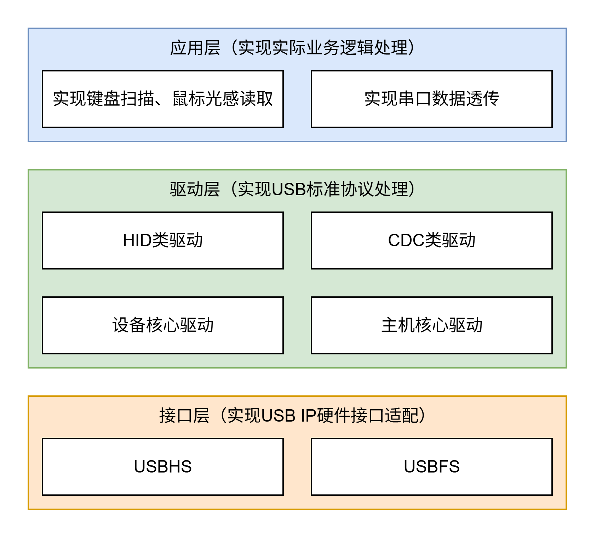

简介
============================

本项目是面向沁恒（WCH）RISC-V 微控制器的轻量级 USB 协议栈，提供统一的设备（Device）与主机（Host）驱动框架。协议栈使用 C 语言实现，不依赖操作系统，硬件无关的核心逻辑与芯片相关的移植代码分离。

主要特性
--------------------

- **设备与主机统一框架**：设备与主机驱动采用一致的句柄模型和板级初始化接口。
- **多 USB 实例**：同一芯片上的多个 USB 控制器可独立工作，可在不同控制器上分别运行设备或主机功能。
- **多种传输速度**：通过 USBFS / USBHS 移植层支持低速、全速和高速设备，具体能力取决于所用芯片的 USB 控制器。
- **按需裁剪**：通过 ``usb_config.h`` 选择启用的驱动并配置句柄池、缓冲区大小，未启用的代码不参与编译。
- **静态资源分配**：句柄、端点池和缓冲区均由静态数组提供，不使用动态内存，RAM 占用在编译期确定。
- **事件驱动与异步传输**：设备事件、类请求和端点传输通过回调通知应用；主机通过任务函数在主循环中推进枚举与传输调度。
- **可选日志**：提供 ``USB_LOGI``、``USB_LOGW``、``USB_LOGE`` 三级日志，输出接口可重定向。

软件架构
--------------------

协议栈的分层逻辑示意图如下。

   协议栈分层逻辑示意图

使用概览
--------------------

设备模式的典型流程：

1. 调用 ``board_usb_init(index, USB_MODE_DEVICE)`` 获取设备句柄；
2. 调用 ``usbd_drv_open()`` 打开设备驱动，并注册所需事件回调；
3. 通常在枚举完成后，调用类驱动的打开接口（如 ``hidd_drv_open()``、``cdcd_acm_drv_open()``）；
4. 通过类驱动的读写接口与主机交换数据。

主机模式的典型流程：

1. 调用 ``board_usb_init(index, USB_MODE_HOST)`` 获取主机句柄；
2. 调用 ``usbh_drv_open()`` 打开主机驱动，并按需打开类驱动；
3. 在主循环中周期性调用 ``usbh_drv_task()`` 及类驱动的 ``*_drv_task()``；
4. 通过类驱动回调获取设备状态和收发结果。
